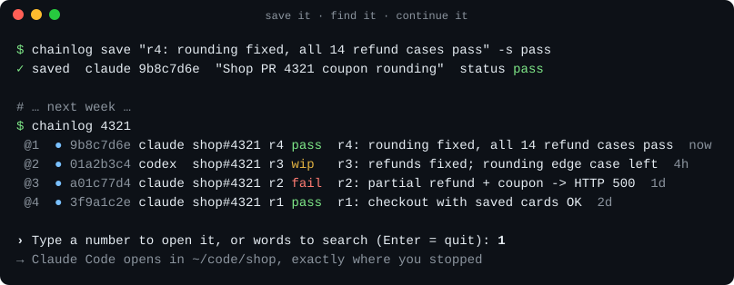
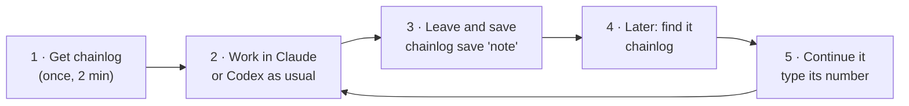
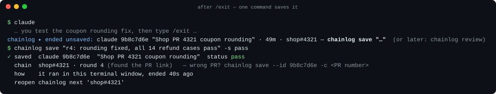
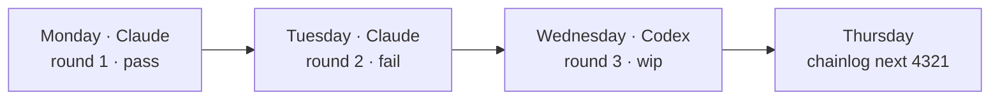
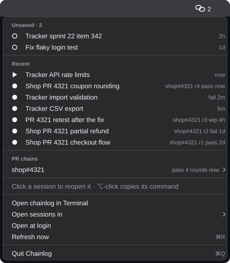
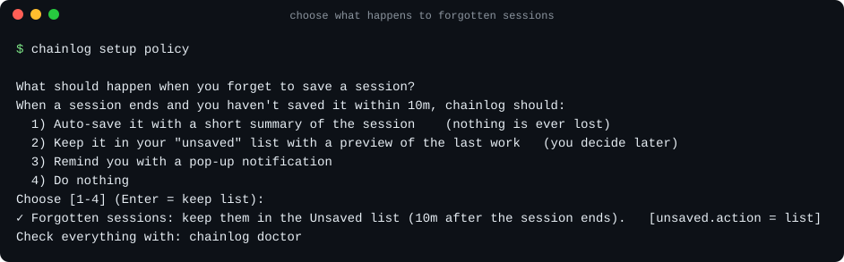
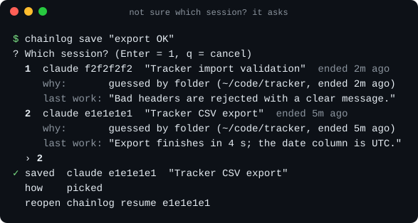

<div align="center">

# chainlog

### Save your Claude Code and Codex sessions with a note, and find them again later.

[](https://github.com/mdismail-cse/chainlog/actions/workflows/ci.yml)


</div>

## What is chainlog?

Every conversation you have with **Claude Code** or **Codex** is a *session*.
When you close a session, it is hard to find again, so people often start over and explain everything again.

**chainlog fixes that.** When you finish a session, you give it a short note.
Later you find it by that note (or by a PR number), and open it again exactly where you stopped.



New words? See [Words used here](#words-used-here) at the bottom.

---

## Your journey



| Step | You do | Time |
|---|---|---|
| 1. [Get chainlog](#step-1-get-chainlog-once) | Paste one line into Terminal and answer a few questions | 2 minutes, once |
| 2. [Work as usual](#step-2-work-as-usual) | Nothing new | — |
| 3. [Save](#step-3-save-when-you-leave) | `chainlog save "what you did"` | 5 seconds |
| 4. [Find](#step-4-find-it-later) | `chainlog` | 2 seconds |
| 5. [Continue](#step-5-continue-where-you-stopped) | Type the session's number | 2 seconds |

## What you need

- A **Mac** or **Linux** computer.
- **Claude Code** and/or **Codex**, already installed.
  - Claude Code in the **Terminal**, in **VS Code**, or in the **desktop app**: all those sessions show up in chainlog.
  - Only use **Codex**? That works too ([see below](#step-1-get-chainlog-once)).
- The **Terminal** app. On a Mac: press `⌘ Space`, type *Terminal*, press Enter. VS Code's built-in terminal works too.

## Is it safe?

- **It stays on your computer.** No account, nothing is sent online, nothing is shared with your team.
  The one exception is AI-written summaries, which you must turn on yourself ([details](SECURITY.md)).
- **It only reads your sessions.** It never changes or deletes them.
- **Setup asks before each change.** It adds:
  - the `chainlog` command;
  - a small add-on to Claude Code and/or Codex;
  - one reminder line in your Terminal settings;
  - optionally, a tiny background timer.
- **You can undo it all** with `chainlog uninstall`.

> **For teams:** each person installs chainlog on their own computer. Notes are personal and are not shared.

---

## Step 1: Get chainlog (once)

1. Copy this line, paste it into **Terminal**, and press **Enter**:

   ```sh
   curl -fsSL https://raw.githubusercontent.com/mdismail-cse/chainlog/main/install.sh | sh
   ```

2. It asks **about 4 short questions**. **Press Enter for each one** (Enter = yes).
   - Type `n` to skip a question, or `d` to see exactly what it would change.
   - The last question is what to do with sessions you forget to save. Enter keeps a simple list.
   - If it instead says *"Next, type: chainlog setup"*, type `chainlog setup` and press Enter.
3. **Close Terminal and open it again.** Type `chainlog`. You'll see your past sessions.

> **Codex users:** one more step, once. Open `codex` and type `/hooks`. Codex lists its hooks: choose the one that mentions **chainlog** and approve it.
> Afterwards `chainlog doctor` shows *Codex approval: approved*.
>
> **Only use Codex, not Claude Code?** Type `n` when setup asks about Claude Code.

<details>
<summary>Other ways to get it: from inside Claude Code, or by asking your AI</summary>

**Inside Claude Code**, type these three lines, one at a time:

```text
/plugin marketplace add mdismail-cse/chainlog
/plugin install chainlog@chainlog
/chainlog:setup
```

**Ask your AI** (Claude Code, Codex …):

> Install chainlog by following https://raw.githubusercontent.com/mdismail-cse/chainlog/main/INSTALL.md

It shows you its plan and asks before changing anything.
</details>

## Step 2: Work as usual

Open Claude Code or Codex in your project folder and work the way you always do.

## Step 3: Save when you leave

1. Leave the session: type `/exit`.
2. In the **same Terminal tab** (or the same pane, if you use several), type a short note:

```sh
chainlog save "checkout works, refund gives error 500"
```

You don't need a session ID: chainlog knows which session you just left in this tab. What you'll see:



| Line | Meaning |
|---|---|
| `✓ saved` | Your note is attached to that session |
| `chain shop#4321 · round 4` | The session was about PR 4321, so it joined that PR's group ([more](#testing-one-pr-over-several-days)) |
| `how` | How chainlog knew which session you meant |
| `reopen` | The command that opens this session again |

(The ID in the picture, like `9b8c7d6e`, is the session's short name. You never need to type it.)

**Optional: add a result** at the end. Use `-s pass`, `-s fail`, `-s blocked`, or `-s wip` (still working):

```sh
chainlog save "refund with coupon gives error 500" -s fail
```

> 💡 If you leave a session without saving, Terminal shows a one-line reminder.
> In VS Code? Type `/chainlog:save your note` in the Claude chat before you close it.
> In the desktop app? Type `chainlog`, find the session's number, then `chainlog save --id @N "note"`.

## Step 4: Find it later

Type:

```sh
chainlog
```


- Each row has a **number**: `@1`, `@2` …
- **Unsaved** (at the top) lists sessions you left without a note.
- Below the list, chainlog asks **"Type a number to open it"**. See [Step 5](#step-5-continue-where-you-stopped).

| Symbol | Meaning |
|---|---|
| `●` | Saved by you |
| `◐` | Saved for you, with a summary ([if you forget](#if-you-forget-to-save)) |
| `○` | Not saved |
| `▶` | Open right now |

**Search** with a PR number or any word you remember. Type it at the prompt below the list, or add it to the command. The results get their own numbers:

```sh
chainlog 4321
chainlog refund
```


## Step 5: Continue where you stopped

At the prompt below the list, **type the session's number and press Enter**:

```text
› Type a number to open it, or words to search (Enter = quit): 1
```

chainlog opens that session again in the right folder, with the right tool (Claude Code or Codex).
The AI remembers your whole conversation.
It opens **in the Terminal** where you typed the command. In VS Code, type it in VS Code's built-in terminal.

> - **Not the right list?** Type a word or PR number at the same prompt to search, then pick a number from the results.
> - **Press Enter** to leave without opening anything.
> - **Prefer one command?** `chainlog resume @1` opens row 1 of the last list printed in this tab. Add `--print` to only *see* the command.

---

## Testing one PR over several days

If you test a pull request (PR) in **rounds**, one session per round, chainlog keeps those sessions together as a **chain**.
That works across Claude and Codex.



| I want to… | Type |
|---|---|
| See every round of PR 4321 | `chainlog chain 4321` |
| Continue the latest round | `chainlog next 4321` |
| Put a session into PR 4321's chain myself | `chainlog save "round 2 done" -c 4321` |


In `chainlog chain`, `@1` means round 1, `@2` round 2, and so on. Type a round's number at the prompt to open it.

A session joins a chain **by itself** when chainlog can see the PR number: from the PR link Claude saw, or from "PR 4321" in the session title.
If it didn't, use `-c 4321` when you save. Wrong chain? Save again with the right `-c` number.

## Save without leaving Claude or Codex

| In | Type |
|---|---|
| **Claude Code** (Terminal or VS Code) | `/chainlog:save checkout works -s pass` |
| **Codex** | *save this to chainlog: checkout works, status pass* |

The first time, Codex asks permission to run chainlog: choose "always allow".
To find an old session from inside, type `/chainlog:find 4321` in Claude Code, or ask Codex *"find my chainlog session for PR 4321"*.

## See your sessions from the menu bar (Mac)



A small icon at the top of your screen shows how many sessions are unsaved. Click it to see your **unsaved** and **recent** sessions and your **PR chains**.
Click a session to reopen it in a new Terminal window, in its own folder. Hold **⌥** while clicking to copy the command instead.

Get it once: `chainlog setup menubar`. It builds a tiny app on your Mac in about 5 seconds and puts it in `~/Applications`.
It needs Apple's command line tools (`xcode-select --install`). Nothing is sent anywhere: the app only runs `chainlog` on your computer.

In its menu: **Open at login** starts it with your Mac, and **Open sessions in** chooses Terminal, iTerm2 or "only copy the command".
Remove it with `chainlog uninstall`.

## If you forget to save

Forgotten sessions show under **Unsaved** **right away** when you type `chainlog`.
Terminal also shows a one-line note just after you leave.
During setup you also picked what chainlog does **10 minutes later** if you still haven't saved:



| Choice | What happens |
|---|---|
| **1. Auto-save** | chainlog saves it for you with a short summary (◐) |
| **2. Keep a list** *(default)* | Nothing extra: it waits under **Unsaved** with a preview of the last thing the AI said |
| **3. Remind me** | A pop-up notification on your screen |
| **4. Nothing** | Nothing happens |

- **Change your choice:** type `chainlog setup policy` and pick a number.
  For 1 and 3 it then asks to turn on a small background timer: **press Enter**, because these choices need it.
- **Save forgotten sessions one by one:** type `chainlog review`. For each session, press a key:

  | Key | Does |
  |---|---|
  | `s` | Save it with your note (you can add `-s fail` at the end) |
  | `a` | Save it with an automatic summary |
  | `r` | Open it again |
  | `f` | Hide it from the lists (nothing is deleted; `chainlog undo` brings it back) |
  | `n` | Skip to the next one |
  | `q` | Stop |


chainlog only acts on sessions that ended **after** you installed it, never on open ones, and once per session.

## If chainlog asks "Which session?"

If two sessions ended at almost the same time in the same project, chainlog **asks** instead of guessing.
Read the titles and the "last work" lines. Press **Enter** for the first one, type its number, or type `q` to cancel:



## Saved on the wrong session?

1. Type `chainlog undo`. This removes your last save.
2. Type `chainlog` and find the right session's number in the list.
3. Type `chainlog save --id @N "my note"`, with your number instead of N (for example `@2`).

---

## Cheat sheet

| I want to… | Type |
|---|---|
| Save the session I just left | `chainlog save "what I did"` |
| …with a result | add `-s pass` / `-s fail` / `-s blocked` / `-s wip` |
| See my sessions and open one | `chainlog`, then type its number |
| Search | `chainlog <PR number or word>`, then type a number to open it |
| Open a session in one command | `chainlog resume @N` (N = its number in the last list) |
| Continue a PR's latest round | `chainlog next 4321` |
| See a PR's rounds | `chainlog chain 4321` |
| Save a note on another session | `chainlog save --id @N "note"` |
| See everything about a session (all its notes) | `chainlog show @N` |
| Undo my last save or change | `chainlog undo` |
| Star a session I want to keep close | `chainlog star @N` (see them: `chainlog ls --starred`) |
| See my sessions from the menu bar (Mac) | `chainlog setup menubar`, then click the icon |
| Handle sessions I forgot to save | `chainlog review` |
| Change what happens when I forget | `chainlog setup policy` |
| Check that everything works | `chainlog doctor` |

Each command has `--help`. Every command and option: **[full reference](docs/reference.md)**.

## Help

<details>
<summary><b>"chainlog: command not found"</b></summary>

Close Terminal and open it again. Still not working? Paste this, press Enter, and open a new Terminal window:

```sh
echo 'export PATH="$HOME/.local/bin:$PATH"' >> ~/.zshrc
```
</details>

<details>
<summary><b>Where are my notes? How do I back them up?</b></summary>

In one private folder on your computer: `~/.local/share/chainlog` (`chainlog doctor` shows it too).
To back them up, copy that folder.
</details>

<details>
<summary><b>How do I update to a new version?</b></summary>

Run the same install line from Step 1 again. Your notes and settings are kept.
</details>

<details>
<summary><b>I use bash, not zsh</b></summary>

Everything works, except the one-line note in Terminal after you leave a session. That note needs zsh, which is the Mac default.
If `chainlog` is "not found", use `~/.bashrc` instead of `~/.zshrc` in the fix above.
</details>

<details>
<summary><b>How do I read <code>chainlog doctor</code>?</b></summary>

The first line tells you if everything works.
- **✓** means fine.
- **!** is an optional suggestion, with the command to fix it on the next line.
- **✗** is a real problem.

"Old sessions" is only advice: see the next question.
</details>

<details>
<summary><b>An old session says "transcript gone"</b></summary>

Claude Code deletes sessions **30 days** after you last used them. Your notes stay, but the session can't be opened again.
To keep sessions longer, ask Claude Code: *"set cleanupPeriodDays to 90 in my ~/.claude/settings.json"*.
</details>

<details>
<summary><b>Codex sessions aren't picked up when I leave them</b></summary>

Run `chainlog setup codex`. Then open `codex`, type `/hooks`, and approve the chainlog entry.
(Your Codex sessions still show in the list and in search before that.)
</details>

<details>
<summary><b>I use herdr, tmux, or several panes</b></summary>

Fine. Save in the pane where you left the session: chainlog never picks another pane's session.
If nothing ended in that pane, it asks you which session you mean.
</details>

<details>
<summary><b>Will it slow things down?</b></summary>

No. It adds about 0.05 seconds when a session starts or ends, and uses a few MB.
</details>

<details>
<summary><b>How do I remove it?</b></summary>

1. Type `chainlog uninstall`. When it asks *Continue?*, **type `y`** and press Enter (Enter alone means no).
2. This disconnects chainlog from Claude Code, Codex and Terminal, and puts your files back exactly as they were.
3. **Your notes and the `chainlog` command stay**, so you can still read old notes.

| To also… | Type |
|---|---|
| Remove the command (keep notes) | `rm ~/.local/bin/chainlog` |
| Delete everything, including notes | `chainlog uninstall --purge` |

If you installed from inside Claude Code, also type `/plugin uninstall chainlog@chainlog` there.
</details>

Still stuck? Run `chainlog doctor`. It checks everything and says how to fix each problem.
You can also [open an issue](https://github.com/mdismail-cse/chainlog/issues).

## Words used here

| Word | Meaning |
|---|---|
| **Session** | One conversation with Claude Code or Codex, from start until you leave |
| **Note** | Your short text about what you did in a session |
| **PR** | A pull request: a code change being tested. `4321` is its number |
| **Chain** | All sessions about the same PR, in order |
| **shop#4321** | A chain's name: your project's name (`shop`), then the PR number (`4321`) |
| **Round** | One session in a chain (round 1, round 2 …) |
| **@1, @2 …** | The numbers in the last list you printed. Use them to point at a session |
| **Terminal tab / pane** | One terminal window, or one part of a split window |

---

<sub><a href="docs/reference.md">Full reference</a> · <a href="INSTALL.md">Install guide for AI agents</a> · <a href="SECURITY.md">Privacy &amp; security</a> · MIT license</sub>
