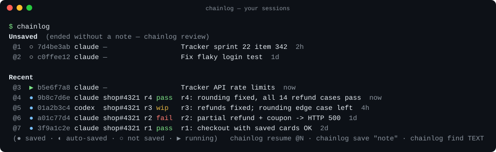
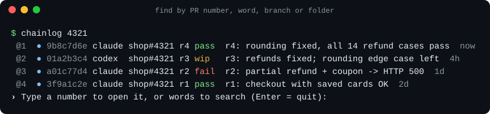
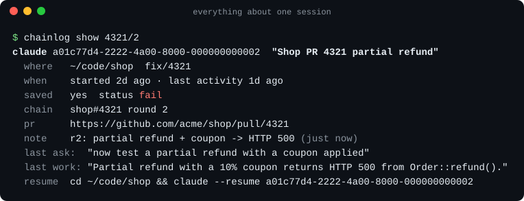
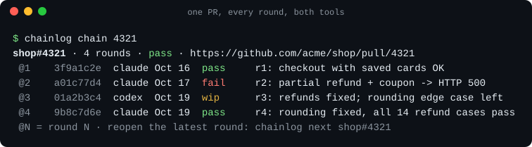
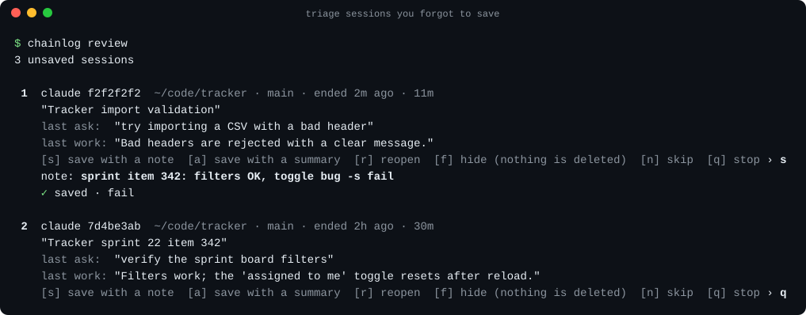
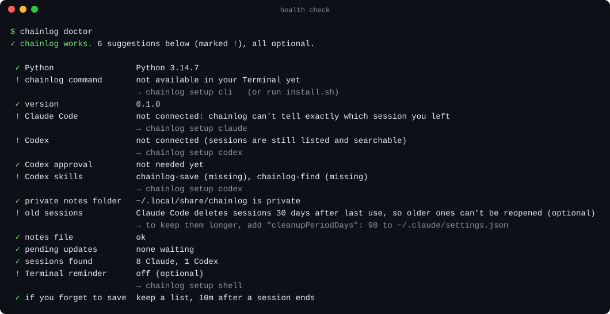
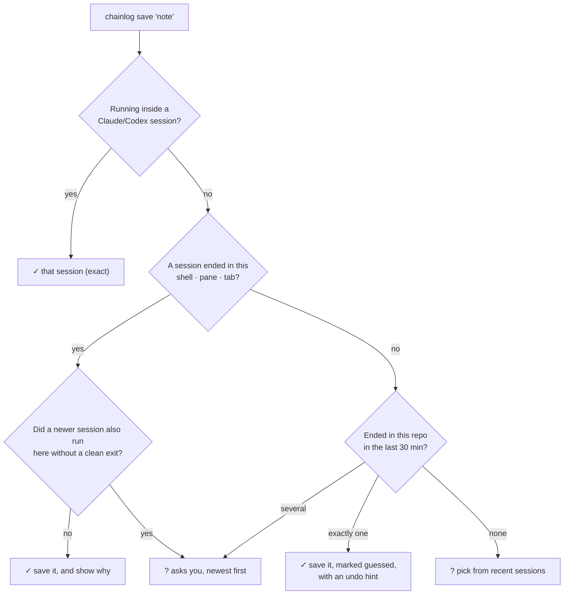
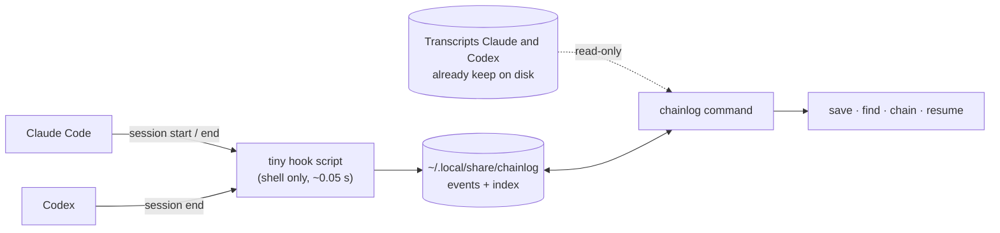

# chainlog reference

Everything chainlog can do, in detail. For a gentle introduction, start with the [README](../README.md).

- [All commands at a glance](#all-commands-at-a-glance)
- [Pointing at a session (REF)](#pointing-at-a-session-ref)
- [save](#save) · [list and ls](#list-and-ls) · [find](#find) · [show](#show) · [resume and next](#resume-and-next) · [chain](#chain)
- [note, status, tag, forget, undo](#note-status-tag-forget-undo) · [review](#review) · [config](#config)
- [setup](#setup) · [doctor, scan, uninstall](#doctor-scan-uninstall)
- [Settings](#settings) · [Environment variables](#environment-variables) · [Exit codes](#exit-codes)
- [How chainlog picks the session](#how-chainlog-picks-the-session) · [The forgot-to-save rules](#the-forgot-to-save-rules)
- [How it works](#how-it-works) · [Development](#development)

---

## All commands at a glance

| Command | What it does |
|---|---|
| `chainlog` | Unsaved + recent sessions, numbered `@1 @2 …` |
| `chainlog save ["note"] [options]` | Bookmark the session you just left (or the one you're in) |
| `chainlog find WORDS` / `chainlog WORDS` | Search everything |
| `chainlog ls [filters]` | List sessions with filters |
| `chainlog show REF` | Everything about one session + its resume command |
| `chainlog resume REF` / `chainlog r REF` | Reopen a session in its folder |
| `chainlog chain [KEY]` | All chains, or one chain's rounds |
| `chainlog next KEY` | Reopen the newest round of a chain |
| `chainlog note REF "text"` | Add a note |
| `chainlog status REF STATUS` | Set the status: `wip`, `pass`, `fail` or `blocked` |
| `chainlog tag REF +add -remove` | Add or remove tags |
| `chainlog star REF…` | Star sessions you want to keep close (favourites); `chainlog unstar REF…` takes them off |
| `chainlog forget REF` | Hide a session from lists |
| `chainlog undo` | Revert your last save / note / status / tag / star / forget |
| `chainlog review` | Go through unsaved sessions one by one |
| `chainlog config …` | Show or change settings |
| `chainlog setup [PART…]` | Install integrations (asks first) |
| `chainlog doctor` | Health check with fixes |
| `chainlog uninstall` | Remove integrations (keeps your notes) |
| `chainlog scan` | Re-index transcripts |

Every command has `--help`.

## Pointing at a session (REF)

| You type | Means |
|---|---|
| `9b8c7d6e` | ID prefix, as shown in lists (any unique prefix of 4+ characters) |
| `@3` | Row 3 of the last list you printed (`chainlog`, `ls`, `find` or `chain KEY`) |
| `last` | The session that ended most recently |
| `4321`, `shop#4321`, `#4321` | The newest round of that PR's chain |
| `4321/2` | Round 2 of that chain |
| `"PR 4321 retest after the fix"` | A Codex thread name |

## save

```sh
chainlog save "note" [-s STATUS] [-c CHAIN] [-t TAG] [--id REF | --pick] [--url URL] [--title TEXT] [--no-chain] [--json]
```

| Option | Meaning |
|---|---|
| `"note"` | What you tested and what happened. Secrets such as tokens and passwords are redacted automatically |
| `-s, --status` | `wip`, `pass`, `fail` or `blocked` |
| `-c, --chain` | Put it in a chain: `4321` (this repo's PR 4321), `shop#4321`, `owner/shop#4321` or a PR URL |
| `--no-chain` | Don't link a chain automatically |
| `-t, --tag` | Add a tag (repeatable): `-t smoke -t mobile` |
| `--id REF` | Save a specific session instead of the one just exited |
| `--pick` | Choose from your recent sessions |
| `--url URL` | Attach a link, e.g. a claude.ai/code session or a ticket |
| `--title TEXT` | Your own title (otherwise Claude's or Codex's title is used) |
| `--json` | Machine-readable output |

- Saving the same session again **adds** another note.
- An explicit `-c` replaces a chain that was linked automatically.
- Notes up to 8,000 characters are kept.

## list and ls

`chainlog` on its own shows **Unsaved** sessions plus the 15 most recent:



| Icon | Meaning |
|---|---|
| `●` | saved by you |
| `◐` | auto-saved with a summary |
| `○` | not saved yet |
| `▶` | still running |

In a terminal, the list ends with a prompt:

| You type | What happens |
|---|---|
| A number | Opens that session (like `chainlog resume @N`) |
| Words or a PR number | Searches, then shows new numbered results |
| Enter | Quits |

`find`, `ls` and `chain KEY` end with the same prompt.
Scripts, pipes, `--json` and AI agents never get it; set `CHAINLOG_NO_PROMPT=1` to turn it off.

`chainlog ls` adds filters:

```sh
chainlog ls --chain 4321        # one chain
chainlog ls --pr shop#4321      # anything mentioning that PR
chainlog ls --here              # this repo only (all its clones)
chainlog ls --since 2d          # last 2 days (90m, 12h, 7d …)
chainlog ls --harness codex     # only Codex (or claude)
chainlog ls --unsaved           # only sessions without a note
chainlog ls --saved -n 50       # only saved ones, up to 50 rows
chainlog ls --starred           # only your starred sessions (★ in every list)
chainlog ls --all               # include empty sessions (opened, nothing typed)
chainlog ls --json              # machine-readable
```

## find

```sh
chainlog find refund coupon     # or just: chainlog refund coupon
```

`find` searches:
- your notes, titles and chains;
- PR numbers and branches;
- folder names;
- the last thing you asked and the AI answered.

Results are ranked by how many of your words match, and filler words such as "the session where I tested" are ignored. `-n` sets the number of rows; `--json` gives machine-readable output.



## show



`--copy` copies the resume command to the clipboard; `--json` gives machine-readable output.
`show` also warns when Claude is about to delete the transcript.

## resume and next

```sh
chainlog resume @3              # reopen a session (alias: chainlog r @3)
chainlog next 4321              # reopen the newest round of a chain
chainlog next 4321/2            # reopen round 2
chainlog resume @3 --fork       # branch off into a new session instead of continuing
chainlog resume @3 --print      # only print the command
chainlog resume @3 --here       # run from the current folder instead of the session's
```

chainlog changes into the session's folder, then runs `claude --resume <id>` or `codex resume <id>`.
- **Still running:** it warns before opening a second copy.
- **Folder gone:** use `--here`.
- **Codex session archived:** it tells you how to unarchive it.

## chain

```sh
chainlog chain           # all chains
chainlog chain 4321      # one chain, every round
```



A session joins a chain:
1. with `-c` when you save;
2. via `CHAINLOG_CHAIN=shop#4321` set before starting the session;
3. automatically, when Claude recorded a PR link, or when the title says "PR 4321" and the folder is a git repo.

- **Chain key:** `<repo name>#<PR number>`, where the repo name comes from the git remote. So clones and worktrees share one chain.
- **Rounds:** ordered by start time.
- **Chain status:** the latest round's status.

## note, status, tag, forget, undo

```sh
chainlog note @2 "retested on Firefox too"
chainlog status 4321 pass                 # the newest round of chain 4321
chainlog tag @2 +firefox -smoke
chainlog forget @5                        # hide from lists
chainlog undo                             # revert the last change of these kinds, or a save
```

## review

Goes through unsaved sessions one by one. For each you can:

| Key | Action |
|---|---|
| `s` | save with a note (you can add `-s fail` and so on) |
| `a` | auto-summary |
| `r` | resume |
| `f` | forget |
| `n` | next |
| `q` | quit |

`--all` includes sessions from before you installed chainlog. Without a terminal, `review` prints JSON.



## config

```sh
chainlog config                           # all settings
chainlog config get unsaved.action
chainlog config set unsaved.action remind
```

## setup

```sh
chainlog setup                            # everything; asks per part
chainlog setup codex shell                # only these parts
chainlog setup all --dry-run              # show every change, apply nothing
chainlog setup all --yes --policy list    # no questions (scripts / agents, after the user agreed)
```

| Part | Installs |
|---|---|
| `cli` | The `chainlog` command in `~/.local/bin` |
| `claude` | The Claude Code plugin (hooks, `/chainlog:save`, `/chainlog:find`, `/chainlog:setup`) |
| `codex` | One `SessionEnd` hook in `~/.codex/hooks.json` and two Codex skills. Afterwards: open `codex`, type `/hooks`, approve it |
| `shell` | One marked block in `~/.zshrc` (the "ended unsaved" hint, plus `~/.local/bin` on your PATH if needed) |
| `policy` | The forgot-to-save question |
| `scheduler` | A 2-minute background timer for `summarize`/`remind` (a launchd agent, or a systemd timer on Linux) |
| `menubar` | The Mac menu bar app: `~/Applications/Chainlog.app`, built from `plugin/menubar/Chainlog.swift` on your machine (needs `swiftc`: `xcode-select --install`) |

- `all` leaves out `scheduler` and `menubar`; name them to get them.
- `--skip PART` leaves a part out.
- Every edited file is backed up, and existing files keep their formatting.
- Without a terminal and without `--yes`, setup only shows the plan.

## Menu bar app (macOS)

`chainlog setup menubar` builds and installs `~/Applications/Chainlog.app` (ad-hoc signed, no Dock icon) and opens it.
Run it again after updating chainlog and it rebuilds the app; `chainlog uninstall` quits and removes it.
Click the icon to open the popover.

| In the popover | What it does |
|---|---|
| **Search** | Searches every session (not only the listed ones) for titles, your notes, PR numbers, branches, folders and what was said, best match first (`chainlog _menu --find`). Enter opens the first match; Esc clears it, then closes. In the Starred tab it only shows starred matches; in Chains it filters the chains |
| **Sessions** tab | **Unsaved · N** (the 8 newest, then "Review all N unsaved…", which runs `chainlog review` in a terminal), then **Recent**. A saved session shows its result as a pill (pass, fail, wip, blocked) |
| **Starred** tab | Every starred session. Starring is `chainlog star` / `unstar`, so the terminal and the app always agree |
| **Chains** tab | Each PR chain, newest first; the newest starts expanded, with "Continue the latest round" and every round |
| Click a session | Opens it in a new window of the terminal you picked, in its own folder (the same command as `chainlog resume`) |
| ⌥-click, or right-click → Copy command | Copies that command instead |
| Hover: ☆ / ★ | Star or unstar. Shown at once; if `chainlog` refuses, it flips back and says why |
| Hover: pencil | Save the session with a note and a result: `chainlog save --id REF [-s STATUS] -- NOTE`. A note that starts with a dash stays a note |
| ⚙ → **Open sessions in** | Terminal (default), iTerm2 (if installed) or "Only copy the command". Remembered |
| ⚙ → **Open at login** | Starts the app when you log in |

A session whose transcript Claude Code already deleted is shown dimmed and cannot be reopened.
The app refreshes when you open it, every minute (one `chainlog` call at a time), and after the Mac wakes. A failed
refresh keeps the last list and says so. It finds `chainlog` in `~/.local/bin`, `/opt/homebrew/bin` or `/usr/local/bin`;
set `CHAINLOG_BIN` to use another one. Terminal windows start an interactive login shell, so `claude` and `codex`
are found on the same PATH as in your own Terminal.

Debugging and tests: `CHAINLOG_MENUBAR_DEBUG=1` prints what the app does to stderr. `Chainlog --dump [FILE]
[--tab starred] [--query TEXT]` prints what the popover shows, as text, without opening a window; `--render OUT.png
[--dark]` draws it to an image; `--act star|unstar|save …` does what a button does. `sh plugin/menubar/build.sh --check`
builds and checks all of it; `--shots DIR` redraws the README images from the sample data.

## doctor, scan, uninstall

- `chainlog doctor` checks every part and prints the fix for anything missing. Use `--json` for scripts.

  
- `chainlog scan` re-indexes transcripts. This happens automatically; `--full` re-reads everything.
- `chainlog uninstall` removes the hooks, skills, zsh block and timer, and keeps your notes. `--purge` also deletes chainlog's data.
  Edited files are restored byte-for-byte. If you edited a file since, only chainlog's own entry is removed.

## Settings

| Setting | Default | Meaning |
|---|---|---|
| `unsaved.action` | `list` | `summarize`, `list`, `remind` or `off` |
| `unsaved.after` | `10m` | How long after a session ends before the policy acts (1m–24h) |
| `unsaved.lookback` | `1d` | Sessions that ended longer ago are never acted on automatically |
| `summary.engine` | `local` | `local` (free, offline), or `auto`, `claude` or `codex` (AI-written; `auto` = the tool that ran the session) |
| `summary.timeout` | `60` | Seconds to wait for an AI summary before falling back to `local` |
| `snippets` | `true` | Store short, redacted previews of the last ask and last answer, which `find` searches |
| `auto_chain` | `true` | Link saves to a PR chain automatically |

## Environment variables

| Variable | Effect |
|---|---|
| `CHAINLOG_CHAIN=shop#4321` | Set before starting a session to put it in that chain |
| `CHAINLOG_HOME` | Where chainlog keeps its data (default `~/.local/share/chainlog`) |
| `CHAINLOG_NO_PROMPT=1` | Lists never ask "type a number to open it" |
| `NO_COLOR` | Colours off |
| `CHAINLOG_COLOR=always` | Colours on even when piped |

## Exit codes

| Code | Meaning |
|---|---|
| `0` | OK |
| `1` | Error |
| `2` | "Ask the user first": an ambiguous session (the candidates are printed as JSON), or setup without consent |

## How chainlog picks the session



- Panes from herdr, tmux and iTerm are told apart, so parallel sessions in one window don't get mixed up.
- When run by a script or an AI, chainlog never asks interactively: it exits 2 with the candidates as JSON.

## The forgot-to-save rules

A session is acted on only when **all** of these are true:
- it ended after you installed chainlog;
- it had at least one prompt;
- it isn't saved;
- it isn't running;
- it's not a sub-agent;
- `unsaved.after` has passed since it ended (30 minutes of inactivity if the tool gave no end signal).

Each session is handled once. A resumed-and-ended-again session gets a fresh turn, and an auto-summary is refreshed. Your own note always wins.

## How it works



- **The hook** records which terminal, pane and shell a session ran in. It never starts Python.
- **The `chainlog` command** reads those records and the transcripts (read-only), and works out titles, PR links, branches and previews.
- **Your saves, notes and statuses** go into an append-only log. Formats: [SCHEMA.md](../SCHEMA.md). Safety: [SECURITY.md](../SECURITY.md).

## Development

```sh
git clone https://github.com/mdismail-cse/chainlog && cd chainlog
make test                     # tests (Python 3.9+, no dependencies)
python3 docs/screenshots.py   # regenerate the screenshots from real output
CHAINLOG_SOURCE=$PWD sh install.sh --no-setup   # install your checkout
```
